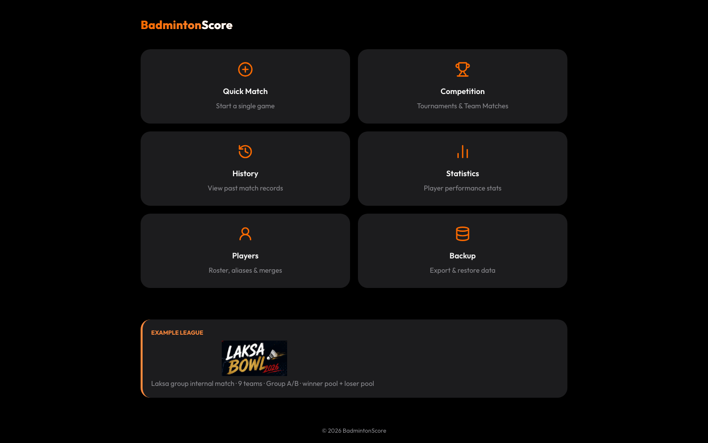
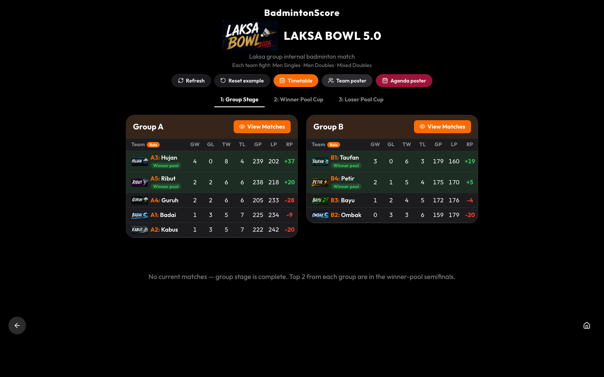
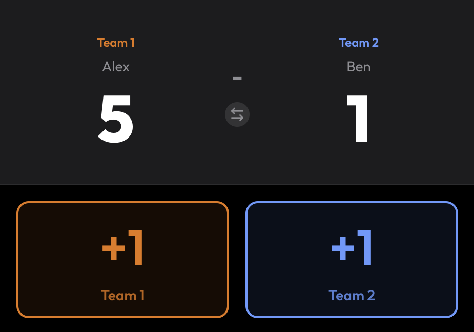

# BadmintonScore

Offline badminton scoring and club competition app. Score a single game, run a team tie, build a knockout bracket, or follow a group-stage league. Everything stays in this browser.

Live site: [https://noowxela.github.io/BadmintonScore/](https://noowxela.github.io/BadmintonScore/)

## What it does

- **Quick Match** — singles or doubles, first to 21 with a 2-point margin, capped at 30.
- **Team match** — men’s singles, men’s doubles, and mixed doubles, with a running tie score.
- **Knockout** — bracket sized to the next power of two, automatic byes, optional bronze match, and a shareable link.
- **League** — group tables (games, ties, and rally points), winner pool, loser pool, and a court timetable. The built-in LAKSA BOWL 5.0 example loads on the home page.
- **Players** — one roster, with aliases and merge so “Alex” and “alex” count as the same person.
- **History and stats** — past games and win/loss totals under the canonical player name.
- **Backup** — export or import a JSON file. Import can replace everything or merge by id.

## Data and backup

There is no server. Matches, drafts, tournaments, and the roster are stored in `localStorage` on this device. Clearing the browser, or opening the site on another phone, starts from an empty board except for the Laksa Bowl example, which is created again on the home page.

To keep a copy, open **Backup** in the app and download the JSON file. Import that file later with **Replace** (this browser becomes a copy of the file) or **Merge** (records are combined by id).

## Screenshots







## Develop

Requires Node.js 20+.

```bash
npm ci
npm run dev
```

Open the URL Vite prints. The app is served under `/BadmintonScore/`, the same base path as GitHub Pages.

```bash
npm run lint
npm run build
npm run preview
```

`npm run preview` only serves the production build on your machine. It does not deploy.

Pushes to `main` deploy through GitHub Actions (`.github/workflows/deploy.yml`). Pull requests run lint and build (`.github/workflows/ci.yml`).

## Stack

React, Vite, React Router. Styles are in `src/index.css`.
